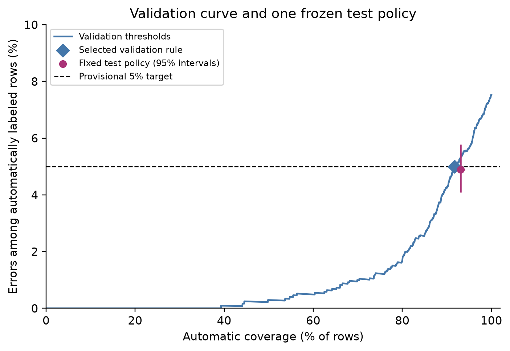

# Dry Bean Classification and Selective Human Review

**A reproducible multiclass benchmark that makes uncertainty visible.**

I built this project to explore a practical question: how accurately can seven supplied bean-variety labels be distinguished from shape measurements, and what happens when lower-score predictions are held for review?

The result is an **internal benchmark**, not a production sorting system. It combines duplicate-aware validation, a transparent model comparison, and an explicit trade-off between automatic coverage and errors among automatically labeled cases.

**Start with the [executed notebook](dry_bean_classification.ipynb)**, inspect the [analysis implementation](analysis.py), or read the [cached metrics](results/metrics.json).

## Results at a glance

| Held-out result | Observed value |
| --- | ---: |
| Full-coverage macro-F1 | 0.9392 |
| Full-coverage accuracy | 92.69% |
| Training-majority baseline macro-F1 | 0.0591 |
| Automatically labeled cases | 2,536 of 2,723 (93.13%) |
| Errors among automatically labeled cases | 124 of 2,536 (4.89%) |
| Conditional 95% group-bootstrap interval for accepted-case error | 4.08–5.78% |
| Cases referred for review | 187 of 2,723 |

The validation-selected rule met the **observed aggregate** 5% error criterion on the held-out test. Its uncertainty interval crosses 5%, and class-specific results differ: SIRA had 45 errors among 471 accepted cases (9.55%). These findings do not establish a population guarantee or deployment readiness.



*Original analysis and visualization by Violetta Kalinicheva (2026), using the UCI Dry Bean dataset. The test point uses one fixed policy; it is not a test-set threshold search. See [attribution](ATTRIBUTION.txt).*

## Data and preparation

- **Source:** [UCI Dry Bean dataset](https://doi.org/10.24432/C50S4B), released in 2020; downloaded November 3, 2026.
- **Observation:** one released row of image-derived measurements, not a supplied photograph or verified independent physical seed.
- **Size:** 13,611 rows, 16 numeric predictors, seven supplied variety labels.
- **Audit:** no missing or nonfinite cells, no constant predictors, and no conflicting labels within identical feature vectors.
- **Repeated vectors:** 68 extra identical vectors, all HOROZ. I retained every row and kept identical 16-feature vectors together across partitions and training folds.
- **Preparation:** no joins, imputation, row deletion, relabeling, unit conversion, or feature selection. Logistic-regression scaling was learned inside each training fold.

The unchanged source archive is included under `data/raw/` under **CC BY 4.0**. Its SHA-256 is `0a64eff5be87f48c3dbbfc0a12a56c5d5b5167ef8e61cd45d69b3e7c7130c06f`. Original feature spellings, including `AspectRation` and `roundness`, are preserved. See [dataset notes](data/README.md) for provenance and rights boundaries.

## Method

1. Audit the preserved archive and reconstruct the prespecified, approximately stratified exact-vector split: **8,163 training / 2,725 validation / 2,723 test rows**.
2. Compare four scaled logistic-regression configurations and four bounded random forests using **five-fold grouped CV within training only**. Select by seven-class macro-F1, with a fixed tie rule.
3. Fit the chosen logistic regression (**C = 100**) on training only. Do not refit on training plus validation.
4. Select a referral threshold using validation only. Keep score ties whole and choose maximum coverage among rules with at most 5% observed accepted-case error. The frozen cutoff is `0.6584236272363831`.
5. Freeze the fitted model and policy, then save one held-out prediction cache. Derive every subsequent test result and figure from that cache.
6. Quantify conditional uncertainty with **2,000 seeded whole-feature-group bootstrap replicates**. Check one-per-vector evaluation weighting without changing training or the policy.

Maximum class scores are used for ranking; I do not claim they are calibrated correctness probabilities. Full design details and seeds are in the unchanged [protocol](protocol.json). Historical milestone labels remain in that file solely because its exact bytes are part of the frozen provenance chain.

## Reproduce or verify

### Environment

The original run used **Python 3.12.14**, a local CPU, and the exact versions in [requirements.txt](requirements.txt). No cloud account, GPU, API key, paid service, or runtime data download is required. A new environment needs internet access to install dependencies; do not assume those packages are already installed.

From this repository's root:

```bash
python3.12 -m venv .venv
source .venv/bin/activate
python -m pip install -r requirements.txt
python -m unittest discover -s tests -v
python verify_cached_results.py
```

On Windows, activate with `.venv\Scripts\activate` instead. `verify_cached_results.py` independently recalculates stored metrics, validation selection, and all 2,000 bootstrap draws. It **does not load the model, fit, or call prediction methods**. It writes `results/cached_verification.json`.

### Cached replay — recommended

Keep the included `results/` directory intact, then run:

```bash
python analysis.py
```

This checks the raw bytes and frozen model/cache hashes, reuses original CV results and policy, and recreates derived summaries and figures. It does not refit or predict test cases again. Generated SVG timestamps and other display metadata may differ even when numerical outputs agree.

To inspect the notebook, open `dry_bean_classification.ipynb` in VS Code or another Jupyter-capable application using the same environment. If needed, register it:

```bash
python -m ipykernel install --user --name dry-bean-classification
```

Select that kernel, keep the working directory at the repository root, and run top to bottom. The notebook checks the preserved cache before the staged replay. Only load the included model if you trust its source: **untrusted joblib/pickle files can execute code**.

### From-scratch replication — separate copy only

The supplied model and cache preserve the original experiment. If you want to repeat fitting, first preserve this repository unchanged. Make a separate working copy containing the code, tests, `protocol.json`, and `data/`, but **without `results/`**. Run the tests and then `python analysis.py` in that copy. This repeats the prespecified comparison, freezes the model and validation rule, and generates test predictions once.

Do not remove just one cache file or alter a model/threshold to improve known test results. A fresh fit may differ with another environment; record the difference rather than tune toward these published values. This portfolio release was checked through **cached replay**, not a new independent training run.

## Repository guide

```text
dry_bean_classification.ipynb  Executed narrative, tables, and five figures
analysis.py                  Staged audit, modeling, policy, and plotting code
verify_cached_results.py     Independent numerical cache verification
tests/test_analysis.py       11 policy, precision, and edge-case tests
protocol.json                Unchanged prespecified analysis design
requirements.txt             Exact execution dependencies
data/raw/                    Unmodified, attributed UCI source archive
results/                     Frozen model, manifests, caches, metrics, and intervals
figures/                     Five original PNG/SVG figure pairs
ATTRIBUTION.txt               Data/source references and transformation notices
LICENSE                      MIT license for original code and documentation
```

## What this work does—and does not—show

The classifier distinguishes labels within the supplied imaging collection. It does **not** establish performance across new farms, cameras, harvests, or batches: those identifiers and original images are absent. Exact-vector grouping is a pragmatic safeguard, not proof of independent biological observations.

The uncertainty intervals condition on the fitted model and frozen rule; they do not include model-search, fitting, threshold-selection, or unknown batch uncertainty. Referring 187 cases withheld 75 erroneous and 112 otherwise-correct predictions. Human corrections, review time, costs, and labor savings were not measured. BOMBAY's zero errors in 105 held-out cases is not proof of zero future risk.

Before considering operational use, I would collect authorized independent batch-level data, confirm measurement/label definitions, agree on class-specific tolerances and reviewer capacity, and evaluate actual review outcomes. This project does not certify food safety, seed health, quality, or authenticity, and no causal claim is made.

## Attribution and license

Original code and documentation: **Violetta Kalinicheva, 2026**, [MIT License](LICENSE). The dataset remains **CC BY 4.0**, not MIT. No source photographs or journal-article text are redistributed. Derived figures and analysis are identified in [ATTRIBUTION.txt](ATTRIBUTION.txt).

- UCI Machine Learning Repository. (2020). *Dry bean* [Data set]. [Dataset DOI](https://doi.org/10.24432/C50S4B).
- Köklü, M., & Özkan, I. A. (2020). Multiclass classification of dry beans using computer vision and machine learning techniques. *Computers and Electronics in Agriculture, 174*, 105507. [Article DOI](https://doi.org/10.1016/j.compag.2020.105507).
- Geifman, Y., & El-Yaniv, R. (2017). Selective classification for deep neural networks. *Advances in Neural Information Processing Systems, 30*, 4878–4887. [Author manuscript](https://arxiv.org/abs/1705.08500). Error–coverage framing only; this project does not implement the formal SGR guarantee.
- [Scikit-learn documentation](https://scikit-learn.org/stable/) for grouped CV, logistic regression, macro-F1, and calibration; reviewed November 9, 2026.
